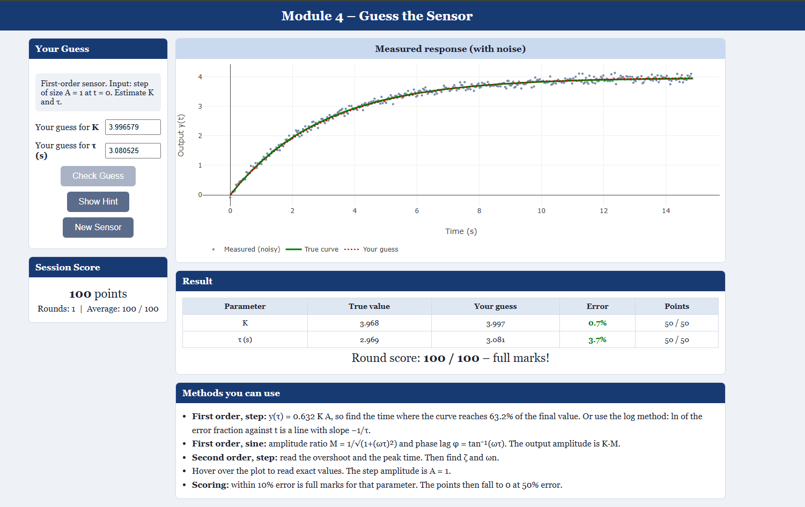
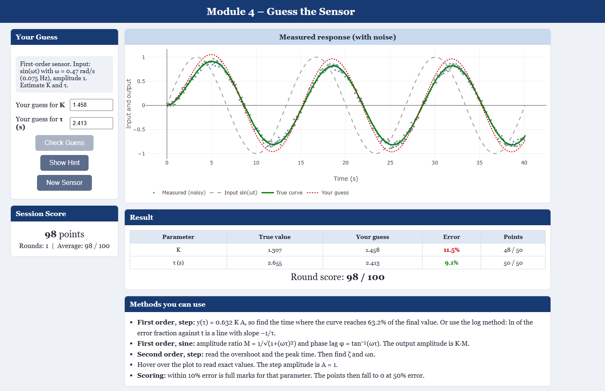
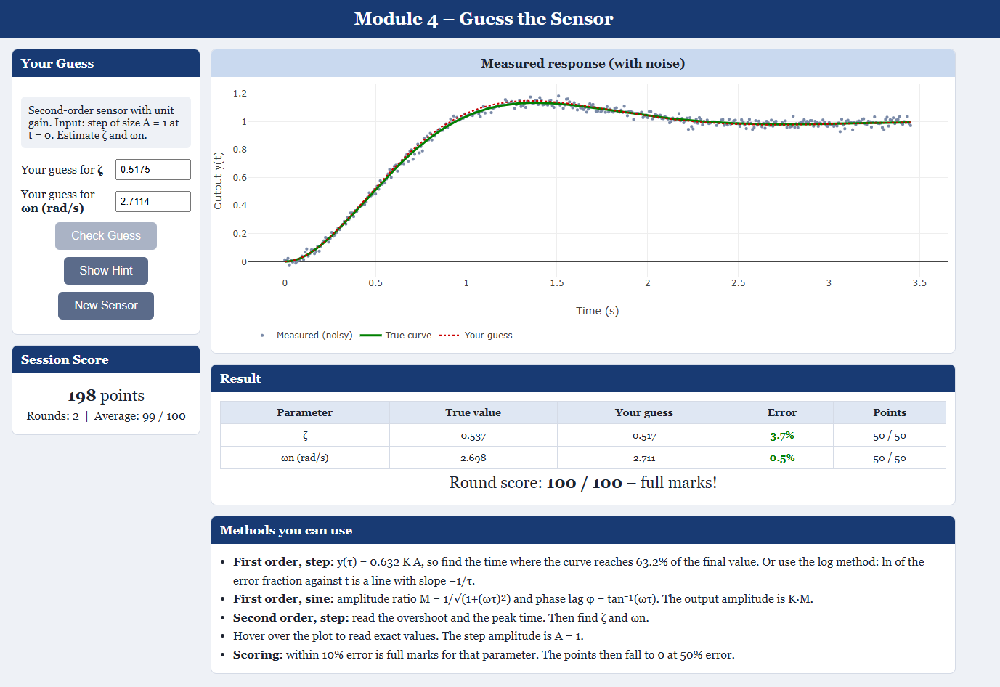

# encs4380-dynamics-team16

https://aleen-730.github.io/encs4380-dynamics-team16/

Aleen Othman: Module 1

Aya Suliman: Module 2

Mirna Musallam: Module 3

Heba Madi: Module 4

## AI Usage – Module 1

I developed the first version of Module 1 myself, including the sliders, step/ramp formulas, Plotly plots, validation checks, and Predict & Check.

I then used an AI assistant (Claude) to:

1. Improve the page layout and make it responsive on mobile devices.
2. Add simple notes to explain the calculations and equations.
3. Extend Predict & Check to five questions.
4. Review the code against the homework requirements.
##  Module 2
I developed the first version of Module 2 myself, including the input sliders, frequency response calculations, Plotly plots, and Predict & Check feature. I then used an AI assistant  to improve the page layout, make it responsive on mobile devices, organize the input parameters and calculated results more clearly, and improve the overall appearance of the plots and interface.

##  Module 3
I developed the first version of Module 3 myself, including the sliders, second-order system calculations, plots, live measurements, and s-plane poles. I used AI to help me improve the interface, organize the information, make the design cleaner and more responsive, and fix some parts of the code.

## AI Usage – Module 4
I worked on the implementation of Module 4, including the sensor guessing interface, parameter inputs, and interactive features. I used an AI assistant to help me:

1. Improve the page styling and make the interface clearer and more user friendly.
2. Improve the graphs' appearance and add interactive features, including hover information.
3. Organize the graph presentation to make it easier to understand and compare the sensor responses.
4. Review the interface and check that the features work as expected.

### Screenshots

### 1. First-Order System with a Step Input

### 2. First-Order System with a Sine Input

### 3. Second-Order System with a Step Input

