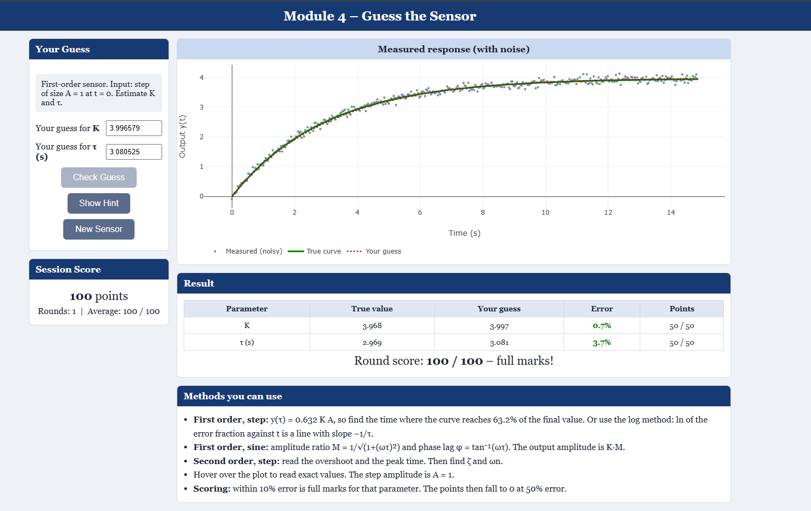
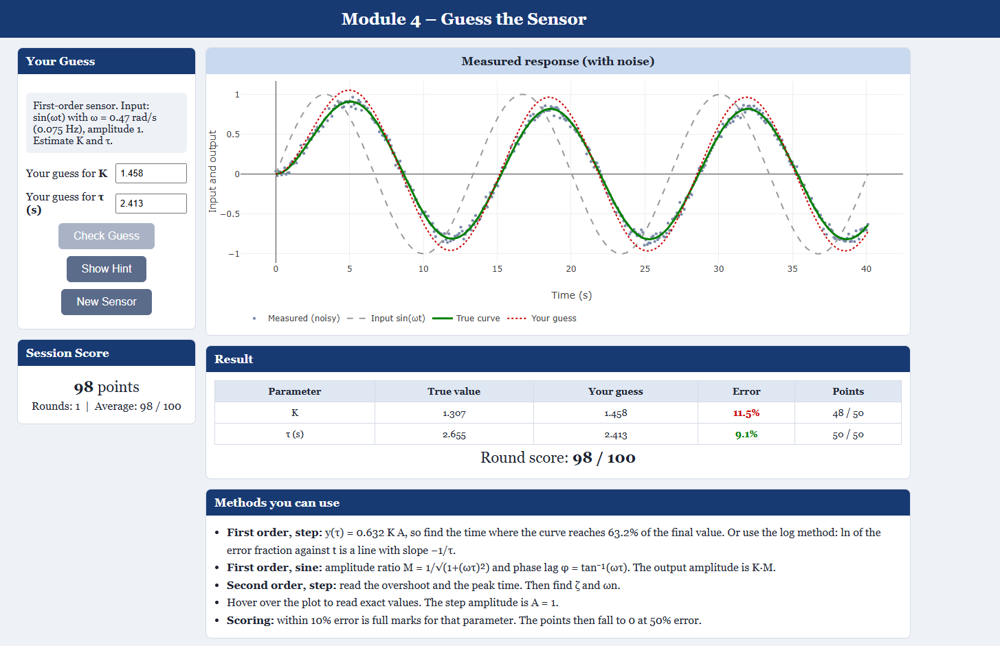
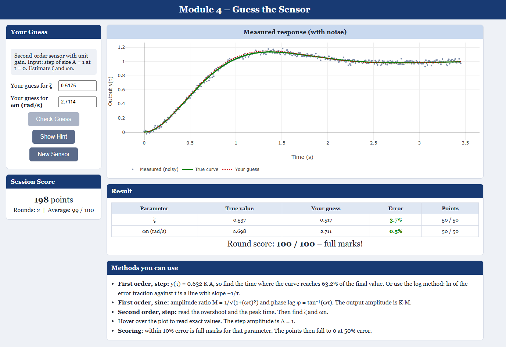
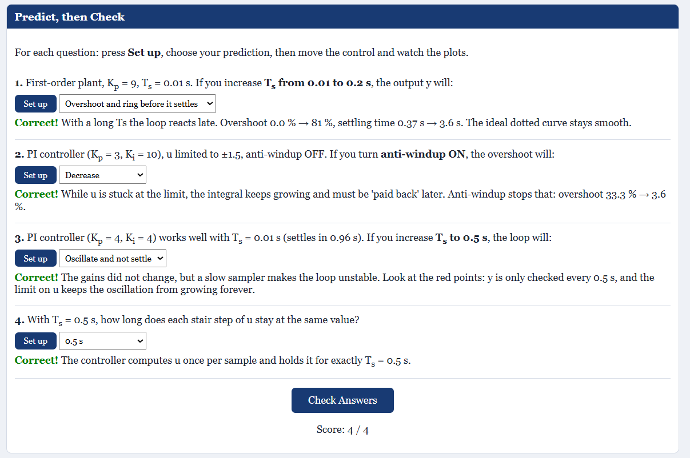

# encs4380-dynamics-team16

https://aleen-730.github.io/encs4380-dynamics-team16/

Aleen Othman 1231626: Module 1 ,  P1 – PID Playground

Aya Suliman 1231411: Module 2

Mirna Musallam 1230042: Module 3, P4 – tuning challenge

Heba Madi 1231286: Module 4,  P3 - Digital PID

Homework 1 – Dynamics

## AI Usage – Module 1

I developed the first version of Module 1 myself, including the sliders, step/ramp formulas, Plotly plots, validation checks, and Predict & Check.

I then used an AI assistant (Claude) to:

1. Improve the page layout and make it responsive on mobile devices.
2. Add simple notes to explain the calculations and equations.
3. Extend Predict & Check to five questions.
4. Review the code against the homework requirements.

##  Module 2
I developed the first version of Module 2 myself, including the input sliders, frequency response calculations, Plotly plots, and Predict & Check feature. I then used an AI assistant  to improve the page layout, make it responsive on mobile devices, organize the input parameters and calculated results more clearly, and improve the overall appearance of the plots and interface.

##  Module 3
I developed the first version of Module 3 myself, including the sliders, second-order system calculations, plots, live measurements, and s-plane poles. I used AI to help me improve the interface, organize the information, make the design cleaner and more responsive, and fix some parts of the code.

## AI Usage – Module 4
I worked on the implementation of Module 4, including the sensor guessing interface, parameter inputs, and interactive features. I used an AI assistant to help me:

1. Improve the page styling and make the interface clearer and more user friendly.
2. Improve the graphs' appearance and add interactive features, including hover information.
3. Organize the graph presentation to make it easier to understand and compare the sensor responses.
4. Review the interface and check that the features work as expected.

### Screenshots

### 1. First-Order System with a Step Input

### 2. First-Order System with a Sine Input

### 3. Second-Order System with a Step Input

## Homework 2 – Control

### P1 – PID Playground

The PID Playground lets users choose a first- or second-order plant and change the PID gains to see how the system responds.

**Simulation:** I initially used Euler, but it gave inaccurate results for some oscillating responses. I switched to RK4 using the example from the State-Space Modeling notes (Sections 6–7).

**AI usage:** I used Claude to help with layout improvements and reviewing and debugging parts of the simulation.

**What the page shows**
- Closed-loop block diagram
- Output y and setpoint r plot
- Control signal u plot, with optional limit lines
- Rise time (10%–90%), overshoot, settling time (±2%) and steady-state error
- Validation checks with PASS/FAIL
- Predict, then check questions
- Mobile-friendly layout

**Validation checks (all pass)**

| Check | Expected | Simulated |
|---|---|---|
| P only, Kp = 9: closed-loop τ | 0.1 s | 0.100 s |
| P only, Kp = 9: steady-state error | 10% | 10.000% |
| PI, Kp = Ki = 1: no overshoot (ζ = 1) | 0% | 0.000% |
| PI, Kp = Ki = 1: time to reach 63.2% (ωn = 1) | 1 s | 1.000 s |
| PI, Kp = 9, Ki = 5: steady-state error | 0% | 0.000% |

### P2 - A slow sensor in the loop
The module explains the effect of sensor time constant (τs) on the system response, including the difference between the true output (y) and measured output (ys), and how sensor delay affects the PID feedback loop. AI tools were also used to clarify concepts that were not fully understood and to improve the screen layout and formatting, making the module easier to understand and use.

### P3 – Digital PID

The Digital PID module lets users explore how a digital PID controller behaves with different PID gains and sampling times, including the effects of saturation and anti-windup on the closed-loop response.

**Simulation:** The controller is implemented in discrete time, updating the control signal at each sampling instant using the digital PID equation. The plant is simulated using RK4 between controller updates to observe the system response.

**AI usage:** I used an AI assistant to help me understand the requirements and the concepts behind the implementation, guide me through implementing the simulation and controller functionality.

**What the page shows**
- Closed-loop simulation of a plant controlled by a digital PID controller
- PID gain inputs (Kp, Ki, Kd)
- Adjustable sampling time (Ts)
- Output y and setpoint r plot
- Stair-step control signal u plot
- Control signal saturation limits
- Anti-windup ON/OFF functionality
- Performance metrics, including IAE, steady-state error, rise time, overshoot, and settling time
- Sampling time experiments to compare the controller response
- Arduino code generation based on the current PID gains
- Predict & Check validation
- Mobile-friendly layout

**Predict & Check:** An interactive quiz that lets users predict how the closed-loop system will behave under different conditions, including changes in sampling time, anti-windup, and controller behavior. Users select their predictions and check their answers against the simulation results.

 ### P4 – tuning challenge
Simulates a hidden random first-order plant and allows the user to tune the PID controller by adjusting Kp, Ki, and Kd.

The user must tune the PID gains without directly seeing the plant parameters and try to satisfy the required performance specifications.

The system evaluates the PID response using:

Overshoot ≤ 10%

Settling time ≤ 2 s

Steady-state error ≤ 1%

The page displays the system response plot and the calculated performance metrics, with a PASS/FAIL result for each requirement.

A New Challenge button generates a new random plant, allowing the user to repeat the tuning challenge with different plant parameters.

 
